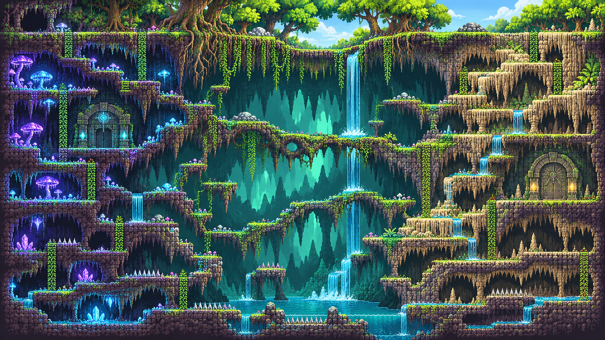
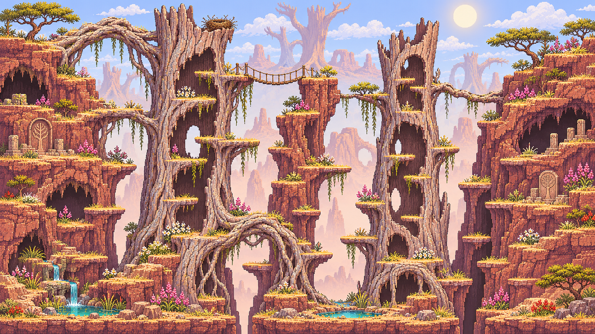
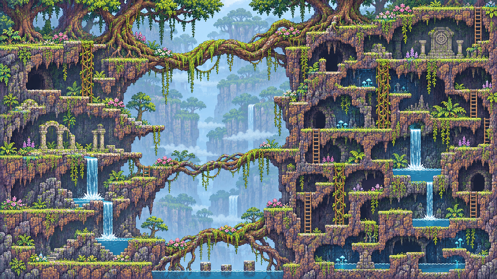

# Sandmaps

An image-led collection of CyberSand **2D side-elevation map concepts**. Priority: natural organic environments, varied traversable layouts, striking negative space and iteration on actual artwork.

**[View the standalone gallery source](index.html)** · Open `index.html` locally for filtering and direct links to the full-resolution originals. All images below link to their original PNGs in this repository.

## Organic seed artwork

[Organic Luminous Cavern](organic-luminous-cavern.png) · [Organic Petrified Trees](organic-petrified-trees.png) · [Organic Root Bridges](organic-root-bridges.png)

## More starting artwork

| Group | Full-resolution originals |
|---|---|
| Gothic | [Gothic Canyon Bridges](gothic-canyon-bridges.png) · [Gothic Sunset Fortress](gothic-sunset-fortress.png) · [Gothic Waterfall Cathedral](gothic-waterfall-cathedral.png) |
| Industrial | [Industrisand 1](industrisand1.png) · [Industrisand 2](industrisand2.png) |
| Fusion | [Fusion 1](fusion1.png) · [Fusion 2](fusion2.png) |

## Provenance

The ten existing PNGs are **seed reference images; their origin is not independently verified**. They are **not** presented as CyberSand World Builder captures. New image-generation work belongs under `art/concepts/` and revised AI artwork under `art/refined/`, labelled accordingly in the gallery. Only genuine captures accompanied by native World Builder evidence may be labelled World Builder output.

Do not replace or downsample the original PNGs to create previews.
