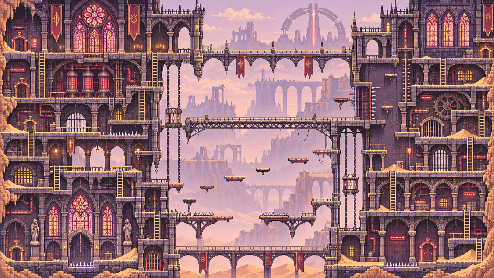
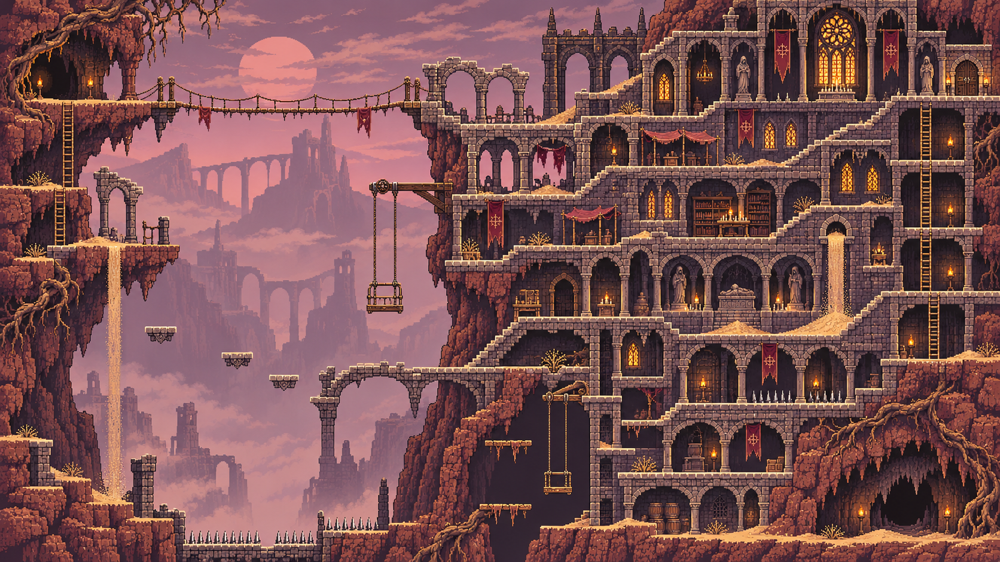
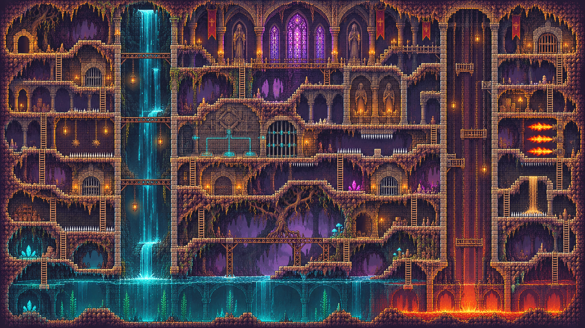
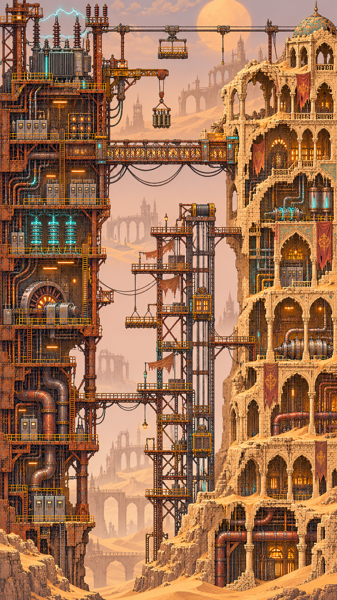
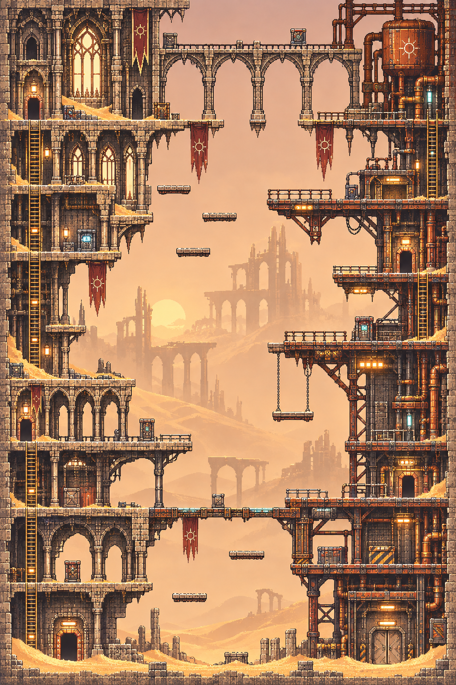
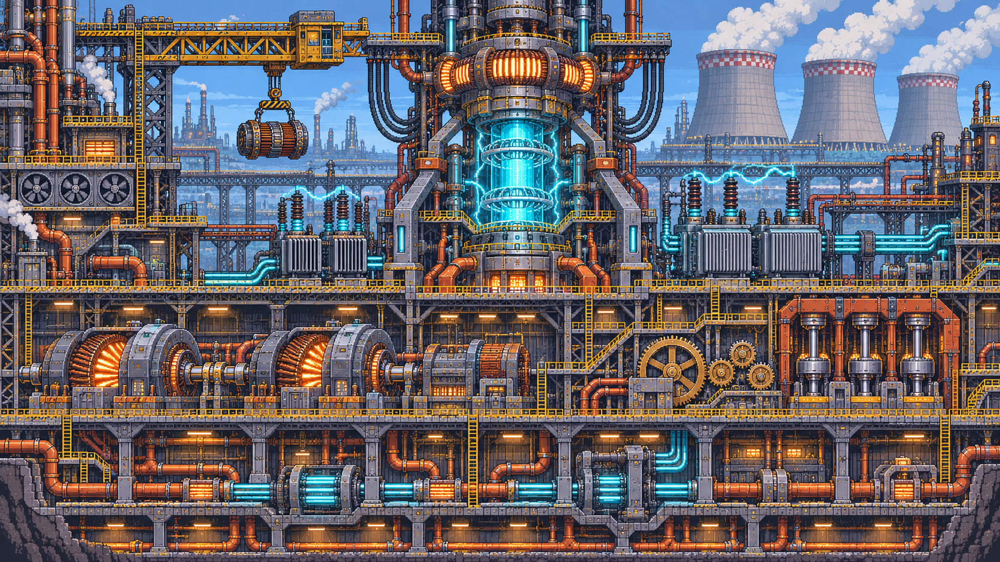
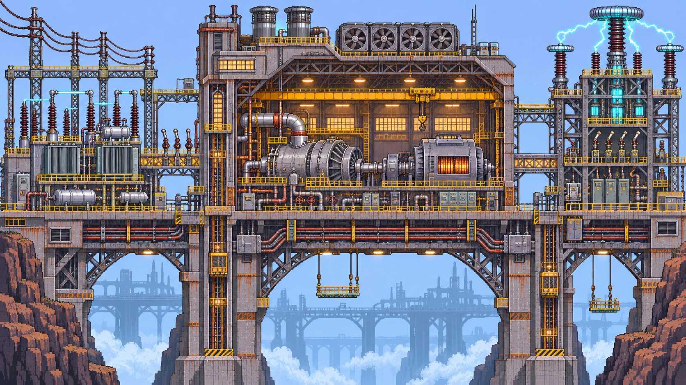
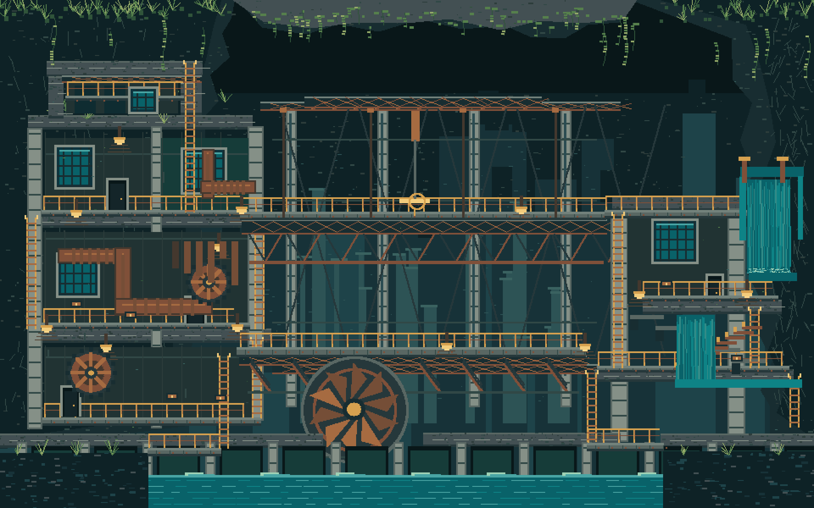
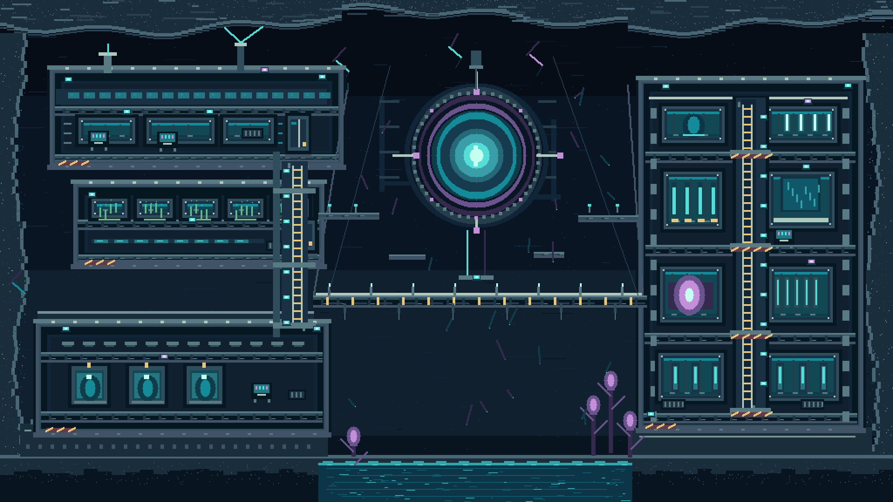

# Sandmaps

An image-led gallery of **CyberSand-inspired orthographic 2D side-elevation map concepts**. Emphasis: traversable layouts, organic environments, striking negative space and spatial variation.

Browse [the standalone gallery](index.html) locally for filtering, or open any image below at its **original full resolution**.

## Organic seed studies

[Luminous Cavern](organic-luminous-cavern.png) · [Petrified Trees](organic-petrified-trees.png) · [Root Bridges](organic-root-bridges.png)

## Gothic seed studies

[Canyon Bridges](gothic-canyon-bridges.png) · [Sunset Fortress](gothic-sunset-fortress.png) · [Waterfall Cathedral](gothic-waterfall-cathedral.png)

## Industrial and fusion seeds

[Industrisand 1](industrisand1.png) · [Industrisand 2](industrisand2.png) · [Fusion 1](fusion1.png) · [Fusion 2](fusion2.png)

## Generated map concepts

[Brackwater Liftworks](art/concepts/industrial-brackwater-liftworks.png) · **AI-generated concept** · 1920 × 1200 · flooded industrial liftworks and spillways.

[Lacuna Array — Underice Signal Vault](art/concepts/scifi-lacuna-array-underice-signal-vault.png) · **Procedurally rendered concept** · 2048 × 1152 · sci-fi side-elevation chamber network.

## Provenance

The ten root PNGs are **seed references of unverified origin**. Newly AI-generated artworks are marked **AI-generated concept**; revised AI artworks will be marked **AI-refined concept**. Procedurally rendered concepts are identified separately. None of these images is represented as actual CyberSand World Builder output. That designation requires a genuine native session and accompanying export evidence. Full-resolution originals are preserved.
